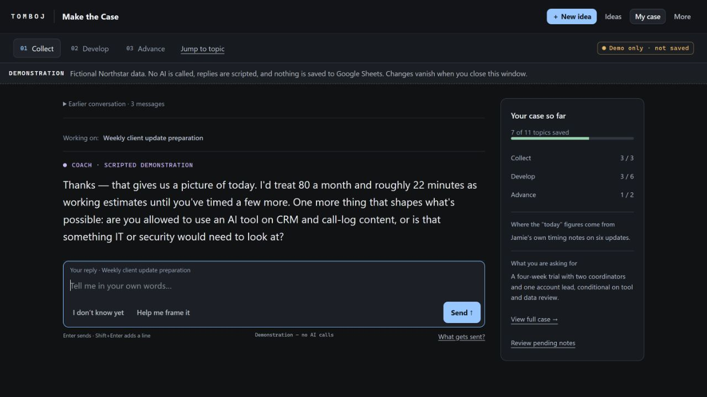

# Innovate — An AI Thinking Partner for Ideas and Decisions

**Work an idea through with AI before it runs ahead with a solution.**

Created by Rachel Wilde / Tomboj. Innovate is a reusable working methodology for AI assistants and interactive agents: flesh out an idea, understand the full context and flow, surface missing pieces, compare approaches, and decide what to do next. An idea does not have to become a project.

**[Read the Innovate skill](TombojInnovateSkill.md)** · **[When to use Innovate or Make the Case](make-the-case/docs/reviewer-guide.md)**

## Why I created Innovate

I created Innovate because AI kept jumping to solutions before I had finished thinking through the idea.

I needed a thinking partner that would help me flesh it out: understand the context, map how it would work, surface missing pieces, and compare the best, cost-effective, and innovative approaches.

That process helped me recognize dead ends earlier—and understand what pursuing a worthwhile idea would actually involve. Sometimes the useful outcome was deciding to stop. When an idea held up, I could move into project planning with a clearer picture of the work ahead.

I still use Innovate in Claude. The instructions can also guide another capable LLM or interactive agent where its platform supports supplied instructions; this is a portable method, not a claim of completed testing on every platform.

## How it works

1. **Flesh out the idea.** The assistant listens, asks one question at a time, reflects your thinking, and maps the intended flow, context, people, dependencies, and missing pieces.
2. **Compare approaches and assess feasibility.** Explore the best, cost-effective, and innovative approaches, making resource requirements, tradeoffs, evidence, and uncertainty visible.
3. **Decide what comes next.** Proceed, investigate, revise, park, or stop. A well-reasoned decision to stop is a useful outcome.
4. **Plan a project if you choose to proceed.** Sequence build stages and validate each stage only when that is the work you want to undertake.

```text
Flow & Scope → Feasibility & Decision
                  ├─ Investigate / Revise → revisit the assessment
                  ├─ Park / Stop → save the reasoning
                  └─ Proceed, if chosen → Build Stages → Validate & Adjust
```

Understanding how the whole solution would work is different from deciding to build it. Innovate helps you explore the former before committing to the latter.

## Use it with an assistant or agent

Supply the complete [TombojInnovateSkill.md](TombojInnovateSkill.md), by uploading the file or providing an accessible link. Ask your assistant to read it and use it as the working guide. If its platform supports named skills, you can configure it there; simply typing `/innovate` does not install or activate a skill on every platform.

A starting prompt:

```text
Read the supplied TombojInnovateSkill.md and use it as our working guide.
Help me think this idea through before suggesting a solution or starting a build.

My idea or situation: [describe it in your own words]
My known constraints: [time, money, tools, access, or unknown]

Reuse the context I have already supplied. Ask one question at a time.
Help me understand the full flow, missing pieces, and three approaches:
best, cost-effective, and innovative. Keep assumptions visible.
Help me decide whether to proceed, investigate, revise, park, or stop.
Save a brief I can use to continue later.
```

For an agent, the same guide can shape authorized research, evidence gathering, option comparison, and preparation of the assessment. Keep the user involved in substantive choices. The Markdown does not itself create tools, persistent memory, execution permission, or organizational approval; those depend on the host system and the actual task.

## Innovate or Make the Case?

**Innovate guides how AI works through an idea with you. Make the Case organizes workplace insight into a proposal and a continuing record.**

| You want to… | Start with |
| --- | --- |
| Talk through a rough idea without AI rushing into answers | [Innovate](TombojInnovateSkill.md) |
| Understand the whole flow, missing context, feasibility, and possible approaches | [Innovate](TombojInnovateSkill.md) |
| Decide whether something deserves more of your time | [Innovate](TombojInnovateSkill.md) |
| Bring a workplace improvement to a manager, sponsor, or reviewer | [Make the Case](make-the-case/README.md) |
| Develop evidence, costs, affected people, permissions, and a specific request | [Make the Case](make-the-case/README.md) |
| Keep multiple ideas, decisions, contributions, and later results together | [Make the Case](make-the-case/README.md) |

Both can begin with a rough idea. Innovate can help strengthen the alternatives within a case; Make the Case can turn an explored idea into a workplace proposal. Neither is a required first step for the other, and neither grants permission to implement a change.

Make the Case includes a separate [portable method](make-the-case/skills/make-the-case/SKILL.md) and an optional Google Sheets application. You do not have to install Innovate to use either.

## What Make the Case looks like

Collect ideas, develop one through dialogue, and prepare a bounded next request. Someone can contribute the insight, evidence, or coordination without being the person who builds the eventual solution.



*Actual built Coach.html running locally in demonstration mode. Fictional Northstar data, scripted replies, no AI calls, and no Google Sheet writes.*

**[See the five-view walkthrough](make-the-case/docs/example-gallery.md)** · **[Set up your own copy](make-the-case/START-HERE.md)**

Make the Case is an early-release kit. See [verification and limits](make-the-case/docs/validation.md) for the completed local checks and remaining live Google/provider checks.

## Attribution and use terms

Read [TombojInnovateSkill.md](TombojInnovateSkill.md) for the Innovate methodology's authorship and use terms. The Make the Case module has its own [license and attribution](make-the-case/ATTRIBUTIONS.md); those do not change Innovate's terms.
