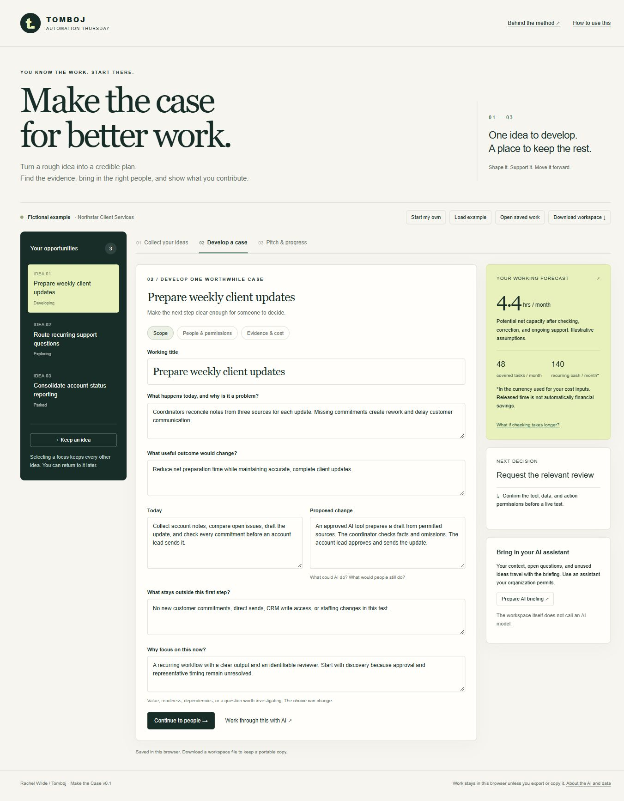

# Make the Case

**Your team wants AI results. Turn what you know about the work into a plan someone can act on.**

Make the Case helps you develop an improvement, find the evidence and collaborators it needs, and keep a record of what you contribute. Start with a frustration, one idea, several ideas, or a proposal that has stalled. You do not need to be able to build the solution yourself.

**[Google Sheets newsletter kit](apps-script/README.md)** · **[Claude HTML design prompt](apps-script/CLAUDE-DESIGN-PROMPT.md)** · **[See the fictional example](docs/northstar-example.md)** · **[Read the method](skills/make-the-case/SKILL.md)**

The newsletter direction is a **reader-owned Google Sheet with an Apps Script conversation interface and the reader's own AI key**. Version 0.4.0 adds clearer resume guidance, individual suggestion review, scrolling/editing fixes, and a Start Here launcher to Claude's integrated [Coach.html](apps-script/Coach.html), with Gemini, Claude, OpenAI, OpenRouter, and Kimi adapters, keys, models, and suggestions. Local tests and browser demonstration checks pass; live Google-account/provider verification remains pending. The screenshot and hosted preview below show the earlier demonstration.



*Local browser capture of the fictional example. The interface is interactive; the underlying figures are assumptions rather than measured business results.*

## Three parts

| Part | What you do | What you keep |
|---|---|---|
| Collect | Describe the work and preserve your opportunities | Context and an idea collection, including ideas you defer |
| Develop | Scope one case, gather evidence, examine costs, map people and permissions | A defensible plan and a clear next-decision request |
| Advance | Capture feedback, decisions, learning, and eventual results | A contribution record and a way to resume the next idea |

## Use the newsletter kit

The [Apps Script edition](apps-script/README.md) creates the tracker, case records, evidence/cost view, context, and history in a reader's own Sheet. It includes server-side provider adapters, user-specific key settings, reviewed AI drafts, persistent records, pitch output, usage limits, and export. Setup is designed for a bound dialog without a separate website deployment. Read [the exact handoff status](STATUS.md) before using or distributing it. An existing Claude interface can use [the provider-settings update prompt](apps-script/CLAUDE-PROVIDER-UPDATE.md).

## Earlier ways to explore the method

**Use an AI assistant.** Supply the [complete skill folder](skills/make-the-case/) and your context to an assistant your organization permits. Follow the starting guide. It asks focused questions, challenges assumptions, and helps you develop the case. The method is written to be assistant-neutral; cross-provider behavioral testing has not been completed.

**Use the browser workspace.** The `dist/` folder contains a working, dependency-free web interface. It keeps multiple ideas, computes scenario economics, highlights missing evidence and permissions, creates a pitch, records decisions, and exports/restores a JSON workspace. Its **Prepare AI briefing** control carries your current work into your chosen assistant. The workspace itself does not call an AI model. It does not upload your records or call company systems.

Start with the fictional Northstar example, then choose **Start my own**. Download the workspace file to retain a portable copy; browser storage is not a backup. See [the data contract](skills/make-the-case/references/records-and-measurement.md).

## What makes the output useful

- A specific decision to request, sized to the available evidence and authority.
- Human responsibilities, affected audiences, learning, support, and collaborators.
- Source-linked facts and visible unknowns; forecasts stay separate from actual results.
- Calculations that include checking, correction, coverage, uptake, and ongoing support.
- Fair credit for discovery, domain expertise, coordination, review, delivery, and adoption.
- All the other ideas retained for later, with reasons and next steps.

An improved proposal can be useful before implementation. It does not grant approval, establish financial savings, or guarantee recognition or job security.

## For leaders

The reader exercise is one practical part of a larger question: how do employee insight and company priorities become supported, governed work with measurable outcomes? [The portfolio case study](docs/portfolio-case-study.md) explains the design choices and the relationship to AI change management.

## Run the workspace locally

Prepare the downloadable starter, then serve `dist/` through any static web server. For example, with Python installed:

```sh
python scripts/package_release.py
python -m http.server 8766 --directory dist
```

Open `http://localhost:8766/`. There is no dependency installation or API key requirement. Opening `index.html` directly as a file may prevent browser module loading.

Maintainer checks use Node.js 18 or newer:

```sh
node --test tests/*.test.mjs
python scripts/package_release.py
node scripts/check-package.mjs
```

## Status and evidence

Version 0.1 is the earlier browser demonstration. Version 0.4.0 includes the conversational Sheets interface and five provider adapters, checked locally with live Google/account/provider checks pending. Northstar people, records, and outcomes are fictional. See [validation](docs/validation.md) for actual checks and limitations, [research](docs/research.md) for the desk-research basis, and [release status](STATUS.md) for delivery details. The newsletter itself is the public experiment; a separately recruited reader test is not a prerequisite.

Created by Rachel Wilde / Tomboj. Original code and written materials are licensed under [MIT](LICENSE), except linked third-party sources and brand identifiers. [Attribution](ATTRIBUTIONS.md) explains provenance.
