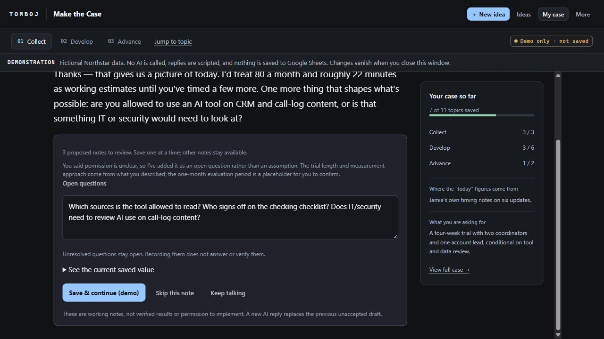
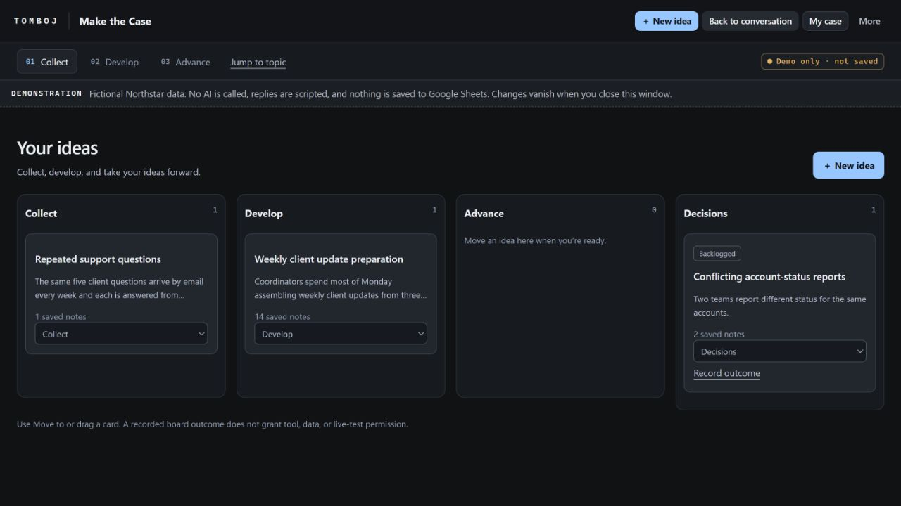
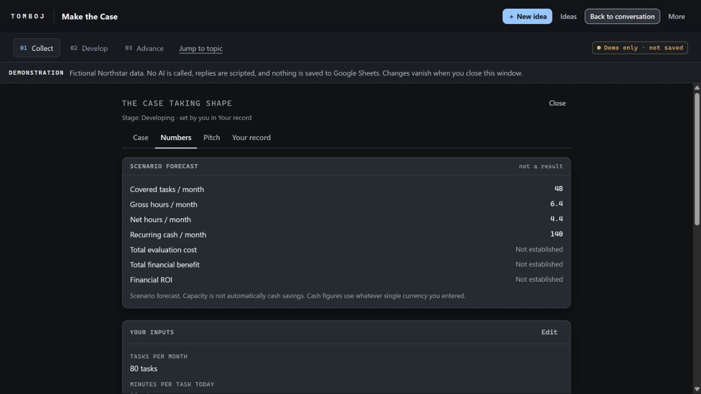
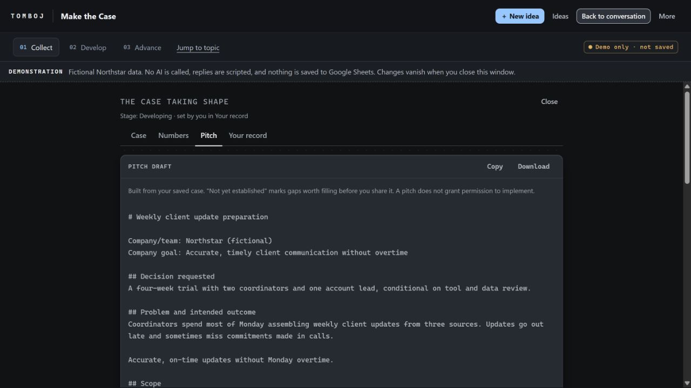

# Make the Case: a visual walkthrough

**Collect ideas. Develop one through dialogue. Advance a specific request.** This example follows Jamie, a fictional client-services coordinator at Northstar, who knows weekly client updates take too long and sometimes miss commitments.

These are captures of the actual built **v0.5.0 Apps Script Coach.html**, opened locally in its demonstration mode at a 1280 × 720 viewport. All company records, people, replies, costs, and proposals shown are fictional. No AI call or Google Sheet write occurred. The installed reader-owned version uses the reader's Sheet and selected AI service; live Google/provider verification remains open.

[Understand Innovate vs Make the Case](reviewer-guide.md) · [Set up your own Sheet](../START-HERE.md) · [Read the fictional case](northstar-example.md)

## 1. Develop one idea through dialogue

**What to do:** Answer the current question in your own words, ask for help framing it, or jump to another topic. Use **New idea** for a separate opportunity.

**What this shows:** The conversation is the main workspace. The reply box follows the current exchange; the right panel summarizes saved case notes. Earlier messages remain available without competing with the current task. Saved-topic counts show record coverage, not proven readiness or business value.

## 2. Review an AI-proposed note before saving it

**What to do:** Edit the proposed text directly, compare it with the current saved value, and choose **Save & continue**, **Skip this note**, or **Keep talking**. The screenshot labels saving as a demo action because it does not write to Google.

**What this shows:** Suggestions are reviewed one at a time. An unanswered permission question remains an open question. Saving a note does not verify it or grant permission. Keeping the conversation going is an explicit alternative to reviewing a note now.

## 3. Keep other ideas and decisions visible

**What to do:** Open **Ideas**, select an opportunity to continue it, or use its move selector to update the board. Add another idea without losing the one already in progress.

**What this shows:** One opportunity is being developed, another is still collected, and another has been backlogged. An empty Advance column accurately shows that none has been moved there. Decision outcomes are recorded separately from tool, data, or live-test permission.

## 4. Inspect the numbers before claiming value

**What to do:** Open **My case → Numbers**, inspect the inputs, and revise them when better evidence arrives.

**What this shows:** In this fictional scenario, scope and uptake reduce the covered work; checking and support reduce gross capacity gains. Net capacity is 4.4 hours a month, not automatic cash savings. Recurring cost is visible, while missing financial inputs leave ROI **Not established**. These are scenario forecasts, not measured outcomes.

## 5. Prepare the next request

**What to do:** Open **My case → Pitch**, review the assembled draft, fill material gaps, then copy or download it for your own review and sharing process.

**What this shows:** The output begins with a bounded decision request rather than a broad promise to transform the business. It carries the problem, scope, people, evidence, scenario, evaluation, permissions, and contribution record forward. Missing information remains visible in the full draft. The screenshot shows its opening; it does not mean the case is finished or approved.

## Continue from here

| You want to… | Next step |
| --- | --- |
| Use the app for your own ideas | [Start here](../START-HERE.md) |
| Use the method inside an assistant instead | [Portable Make the Case skill](../skills/make-the-case/SKILL.md) |
| Review the branch's purpose and scope | [Reviewer guide](reviewer-guide.md) |
| Check evidence and remaining live tests | [Validation](validation.md) |

Screenshots captured 2026-10-28. The images show the built app's demonstration mode, not the separate design-only web preview.
